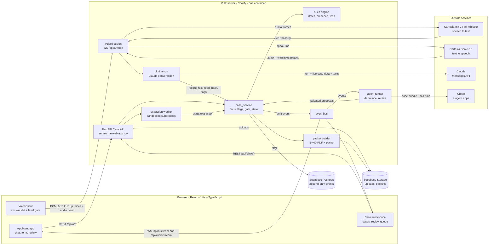
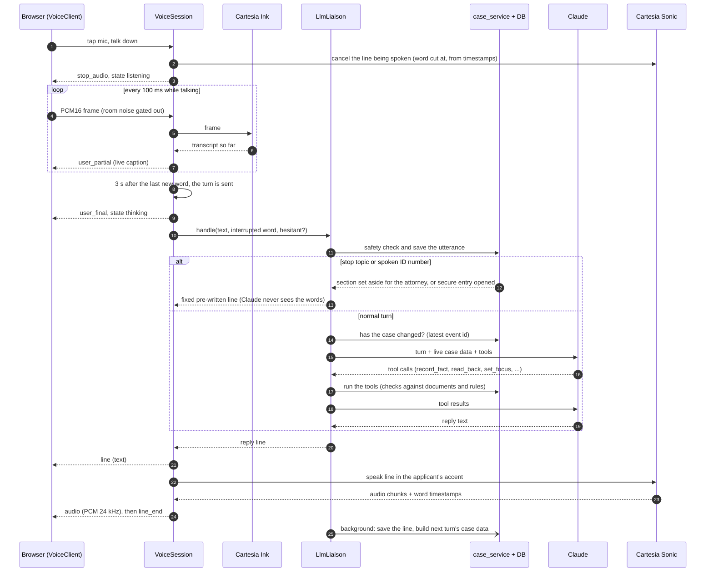
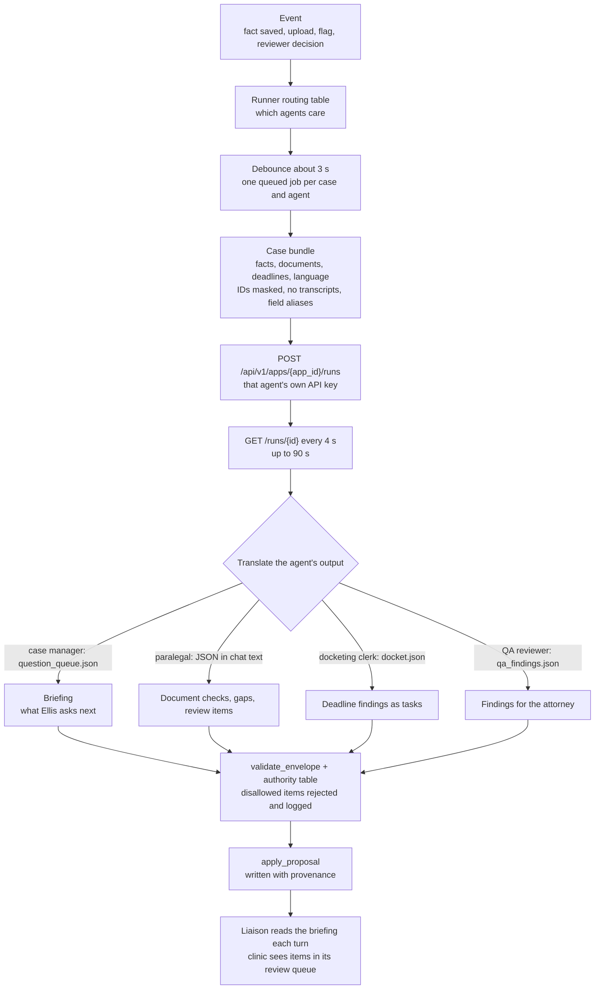
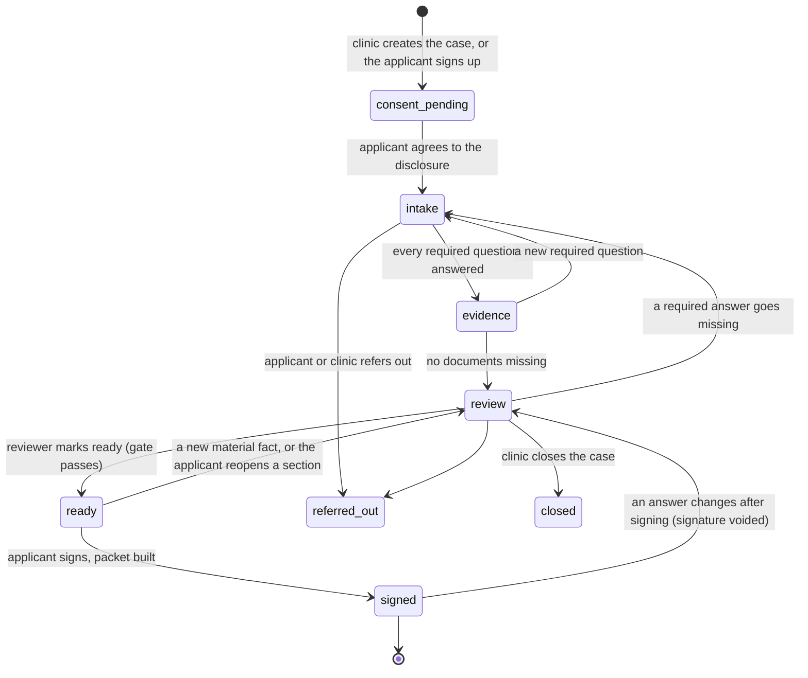

# Ellis system design

Ellis is one FastAPI service, deployed as a single Docker container on a Vultr server with Coolify, that also serves
the React app. The applicant talks through Cartesia; Claude runs the conversation through tools that call our own
case logic; four Creao agents work the case in the background; the clinic reviews before the applicant signs.
Ellis never files and never gives legal advice.

## 1. Architecture

| Layer | Technology | Code |
|---|---|---|
| Hosting | Docker on Vultr, deployed by Coolify (HTTPS, redeploy on push to `main`) | `Dockerfile` |
| Web app | React, Vite, TypeScript, served by the API from the same origin | `frontend/src` |
| API | FastAPI on Python 3.12, one process | `backend/ellis/api` |
| Data | Postgres and private file storage on Supabase; Alembic migrations | `backend/ellis/db.py`, `services/storage.py` |
| Voice | Cartesia Ink-2 (en, es, fr, hi, ja) or ink-whisper (other languages), Sonic 3.6 in 44 languages | `backend/ellis/voice/cartesia.py` |
| Conversation | Claude with tools; fixed legal lines in `scripts_<lang>.yaml` | `voice/llm_liaison.py`, `prompts/liaison.md` |
| Staff agents | Four Creao apps behind one typed proposal format | `backend/ellis/agents` |
| Rules | Pure, versioned rules for dates, physical presence and fees | `backend/ellis/rules/engine.py` |
| Languages | Every Sonic language and accent, from one list | `backend/config/languages.yaml` |

Run **one** instance: the agent runner and the event bus live in the API process.

## 2. One spoken turn

## 3. The Creao staff agents

Agents propose; they never write to the case. A run that fails or returns invalid output writes nothing and leaves
a task on the clinic's board.

## 4. Case lifecycle

The ready gate passes only when every required answer is confirmed by the applicant, no blocking review item is
open, the QA memo is newer than the last material change, the rules ran on the current config, and no document is
still being read.

## Safety rules the design enforces

- **Stop topics never reach the model.** Arrest, removal, false citizenship claims, fraud and danger are caught by
  a keyword check in English, Spanish and the applicant's language before Claude sees the turn. Only the category
  is stored; the section is set aside and the case blocked until a licensed professional resolves it.
- **Sensitive numbers are typed, never spoken.** A spoken ID number is removed from the turn and the secure entry
  opens; models only ever see tokens like `[A_NUMBER]`, and the real values live in an AES-GCM vault.
- **Models never compute dates or fees.** The rules engine does, from a versioned config.
- **Nothing is overwritten.** Corrections supersede earlier facts, and the event log is append-only.
- **Audio is not stored.** Only conversation text is saved.
- **Ellis never files.** The clinic reviews and the applicant signs; the applicant or the clinic files with USCIS.
